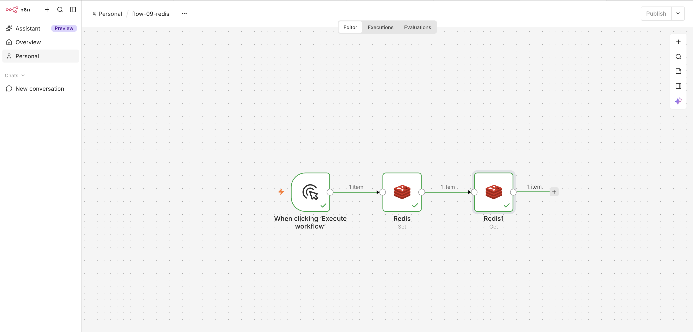
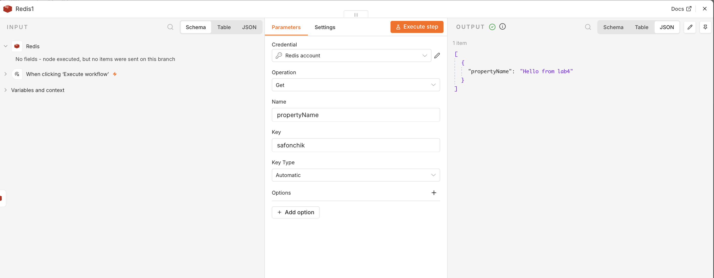
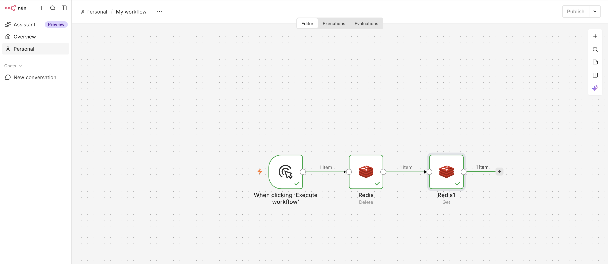
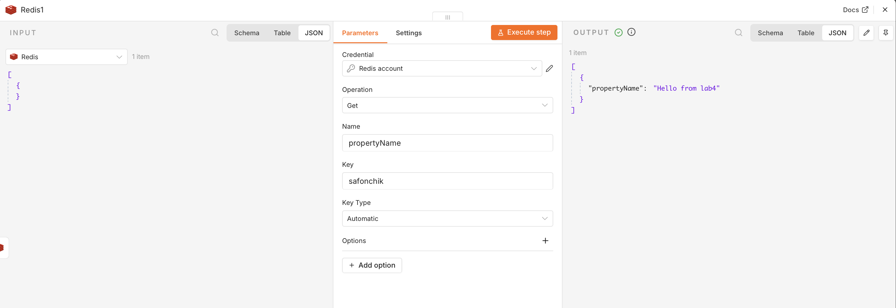

# Работа с Redis в n8n

## 1. Запуск Redis в Docker
Для хранения данных использовался Redis, запущенный в отдельном Docker-контейнере. 
Команда запуска:
docker run -d --name redis-lab4 -p 6379:6379 redis:7

## 2. Настройка Credentials в n8n
Для подключения n8n к Redis, был создан новый Credential:
- Host: host.docker.internal  
- Port: 6379
- Все остальное оставлено пустым

## 3. Flow 09 - Создание и чтение ключа
Цель: записать значение по ключу ( фамилия) и затем прочитать его.
Схема: Manual Trigger -> Redis (Set) -> Redis (Get)

- В узле Set в поле Key указано safonchik, в поле Value — Hello from lab4.
- В узле Get мы запрашиваем значение по этому же ключу.
- В результате выполнения во втором узле мы видим записанное значение, что подтверждает успешную запись и чтение.

Скриншоты

## 4. Flow 10 — Удаление и проверка отсутствия ключа
Цель: удалить созданный ранее ключ и убедиться, что его больше нет.
Схема: Manual Trigger -> Redis (Delete) -> Redis (Get)

В новой версии n8n операции Exists нет, поэтому для проверки используется Get.
- В первом узле Delete мы удаляем ключ safonchik.
- Во втором узле Get мы пытаемся прочитать этот же ключ. Так как он удален, узел возвращает пустой результат (или null), что доказывает успешное удаление.

Скриншоты Flow 10:

