# Лабораторная работа №4. n8n

## 1. Краткое описание выполненного
В ходе лабораторной работы на базовом уровне я освоил платформу автоматизации n8n. 
- n8n развернут локально через Docker с использованием двух volume для сохранения данных и файлов.
- Освоены следующие ноды: Manual Trigger, Set (Edit Fields), Code, IF, HTTP Request, Schedule Trigger, NoOp, Redis.
- Настроено подключение к Redis (через Docker) и реализованы workflow для создания/чтения и удаления/проверки ключей.
- Выполнена ачивка.

## 2. Использованные AI-промпты
1. «Как запустить n8n в Docker на macOS, чтобы сохранялись данные, но не было ошибок доступа к папкам (permission denied)?»
2. «В новой версии n8n нет операции Exists для Redis. Что использовать вместо? Как проверить, что ключ удален?»

## 3. Освоенные ноды
- **Manual Trigger**: ручной запуск.
- **Set (Edit Fields)**: создание и изменение полей (payload, topic, timestamp).
- **Code (JavaScript)**: написание скриптов 
- **IF**: ветвление потоков по условию 
- **HTTP Request**: GET-запросы к публичному API.
- **Schedule Trigger**: запуск по расписанию.
- **Redis**: операции Set, Get, Delete.
- **NoOp**: пустая операция для завершения ветки.
- **Webhook + Write Binary File**: для реализации REST API (ачивка).

## 4. Скриншоты workflow

*   **Запуск в Docker:** 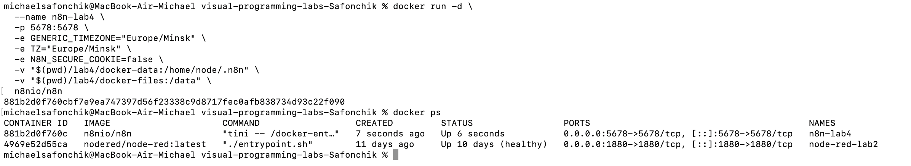
*   **Flow 01 (Manual-Set-Code):** 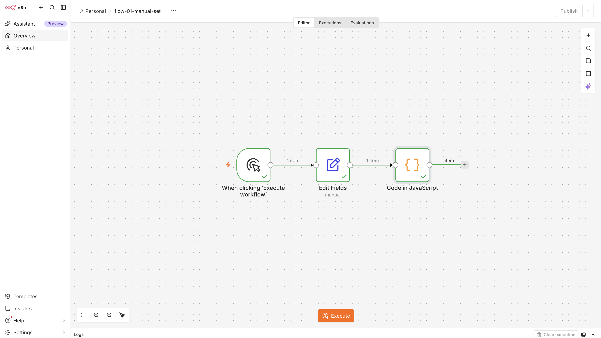 Результат: 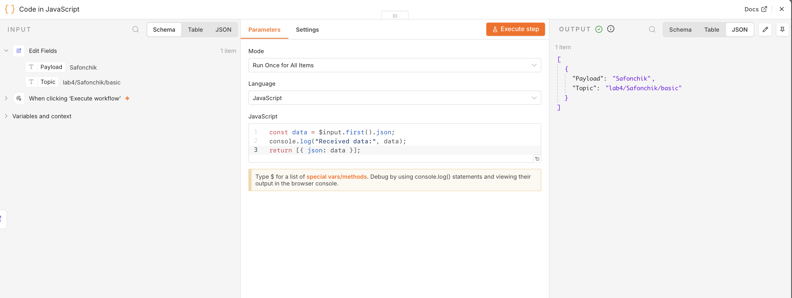
*   **Flow 02 (Code):** 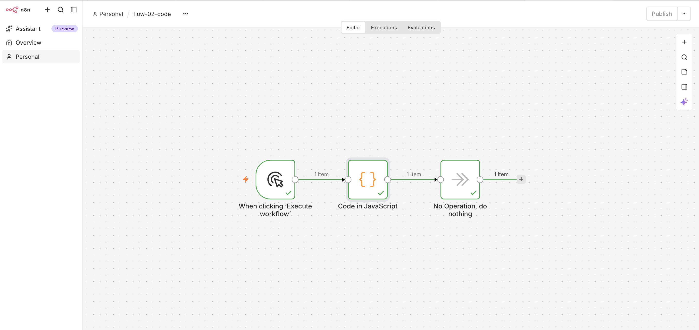 Результат: 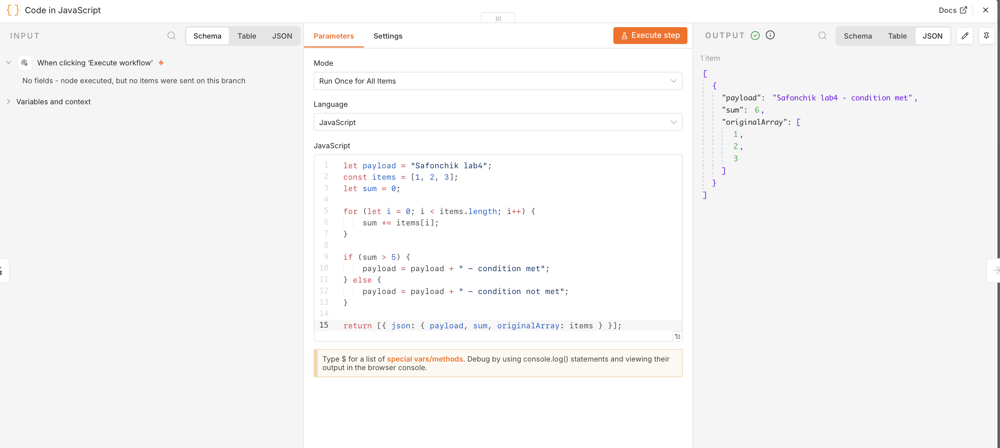
*   **Flow 03 (IF):** 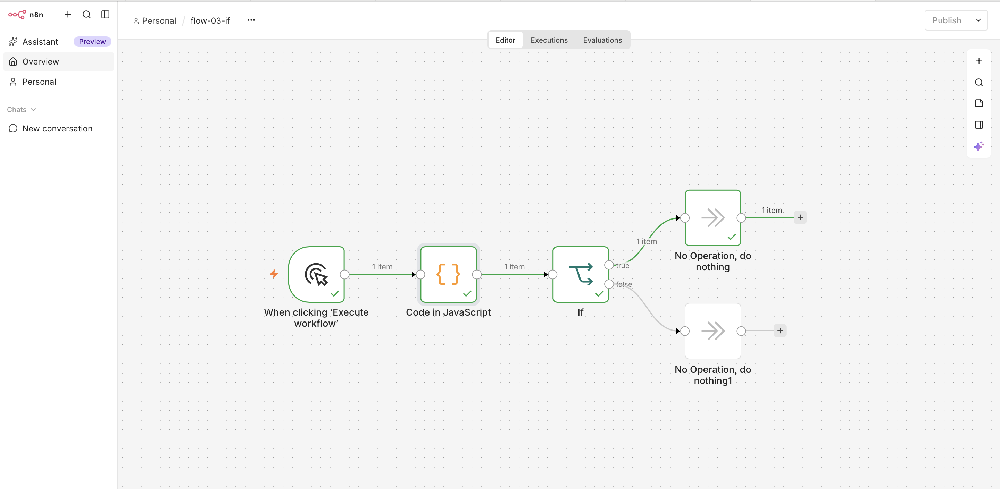 Результат: 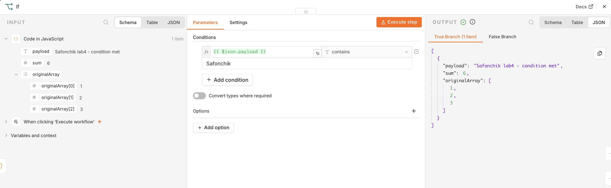
*   **Flow 04 (Set):** 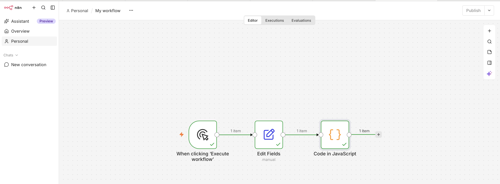 Результат: 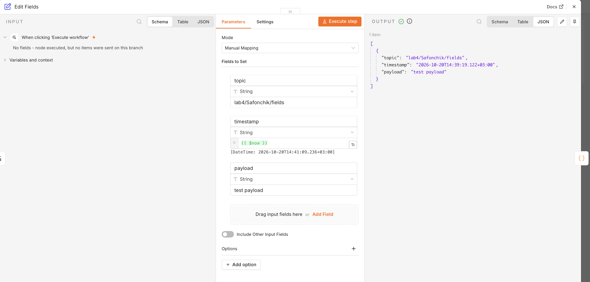
*   **Flow 05 (HTTP):** 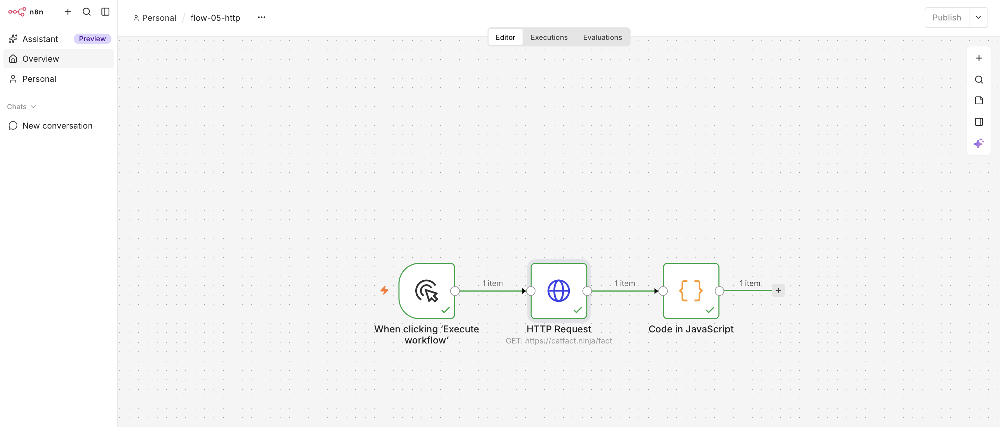 Результат: 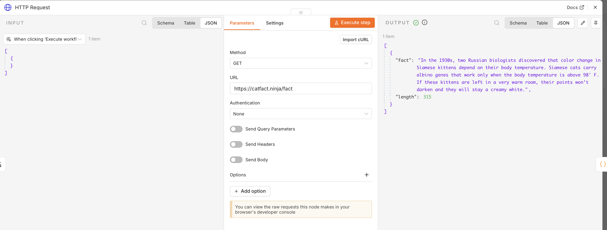
*   **Flow 06 (Schedule):** 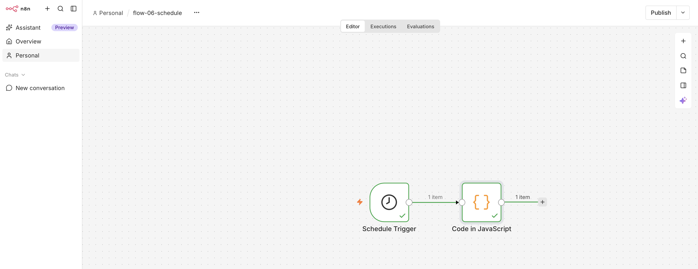 Результат: 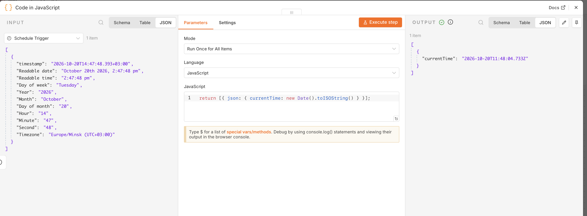
*   **Flow 09 (Redis Set/Get):**  Результат: 
*   **Flow 10 (Redis Delete/Get):**  Результат: 

## 5. Выполнение ачивки 5.3: REST API для заметок на .json-файле

**Что сделано:**
Реализован полноценный REST API для управления заметками (CRUD — Create, Read, Update, Delete). API построен на базе одного узла Webhook в n8n, который принимает 4 разных HTTP-метода, и использует локальный `.json`-файл в качестве базы данных.

**Архитектура API (эндпоинты):**
Все запросы отправляются на один адрес: `http://localhost:5678/webhook/notes`
1. **POST** — создание новой заметки (генерируется уникальный ID, дата и текст).
2. **GET** — чтение всех существующих заметок.
3. **PUT** — обновление текста заметки по её ID.
4. **DELETE** — удаление заметки по её ID.

**Особенности реализации:**
* Ветвление логики реализовано через 4 отдельных выхода узла Webhook.
* В ветках обновления и удаления (PUT/DELETE) данные из входящего запроса считываются напрямую из узла Webhook с помощью выражения `$('Webhook').first().json.body`, чтобы избежать потери данных при чтении бинарного файла.
* Написаны защищенные скрипты на JavaScript (с использованием `try/catch`), которые не падают с ошибкой, если файл пуст или еще не создан.

**Скриншоты:**
*   Схема Workflow (4 ветки CRUD): 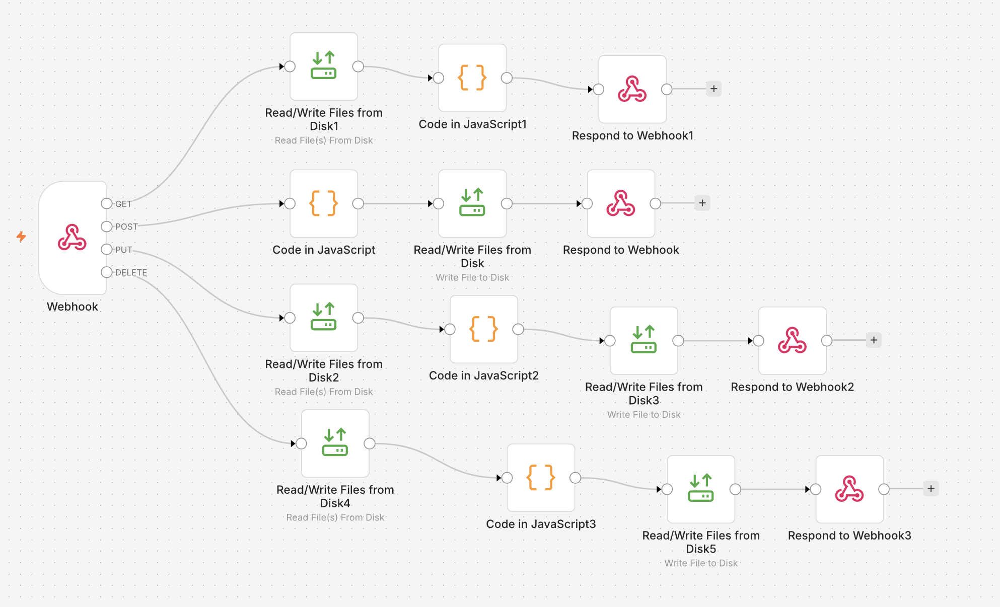
*   Тестирование API через терминал:
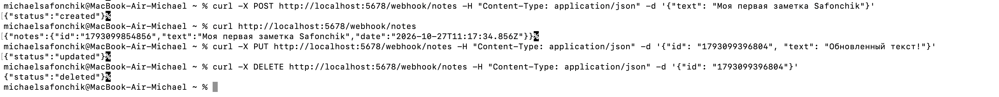

## 5. Выводы
В ходе работы я научился разворачивать n8n в изолированной среде Docker.  n8n позволяет быстро создавать интеграции: от простых скриптов на JS до взаимодействия с базами данных (Redis) и внешними API. Также я разобрался, как работают триггеры (ручные и по расписанию) и как передаются данные между узлами (в формате JSON). 
