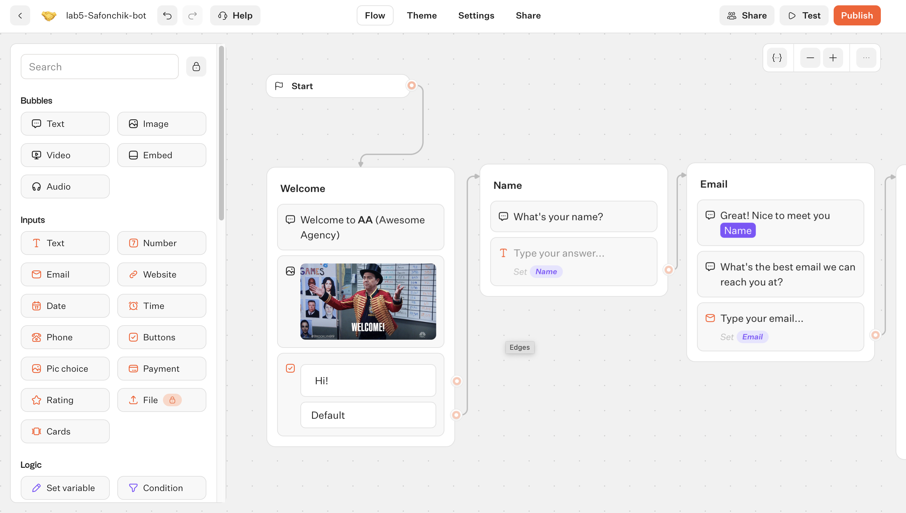
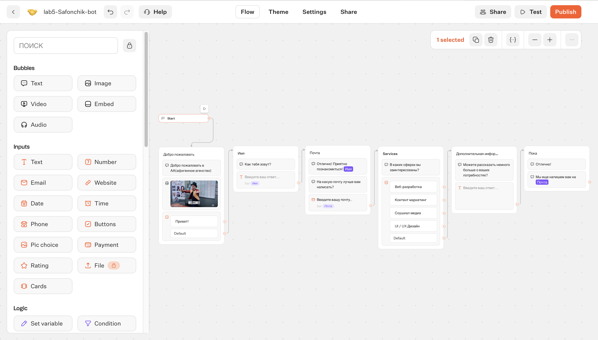
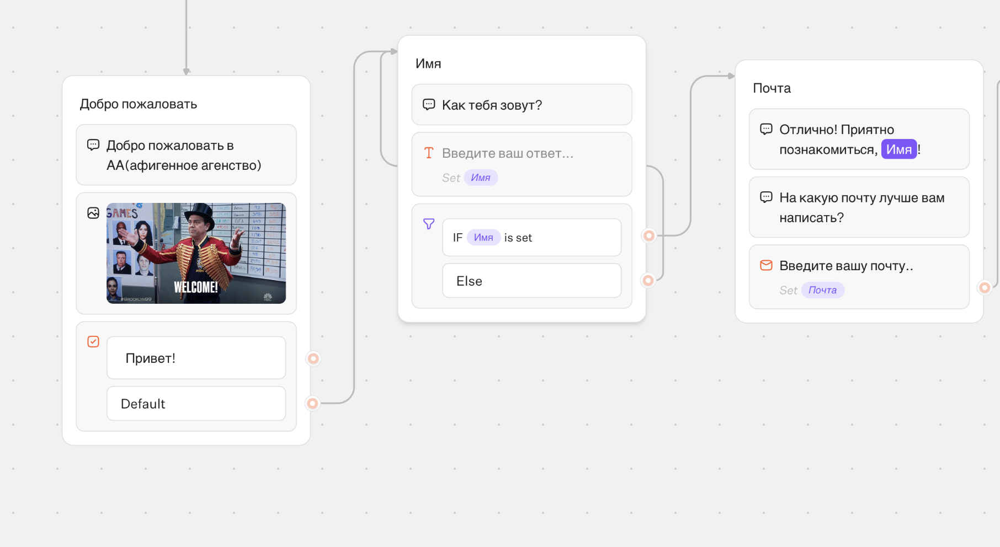
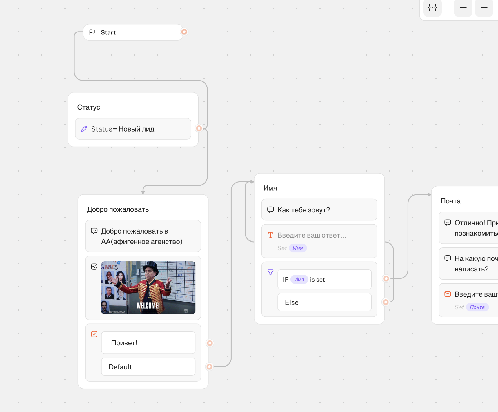
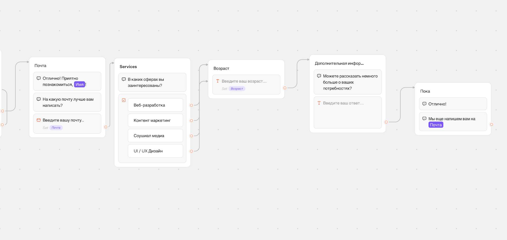
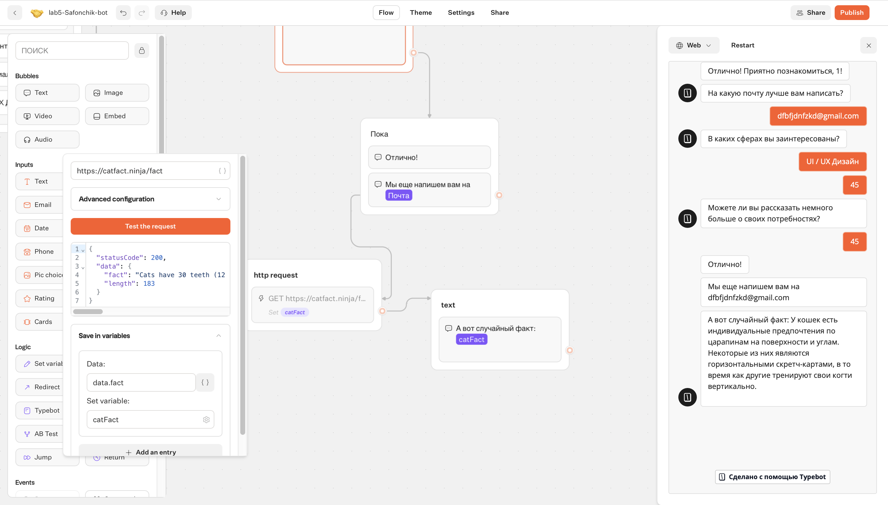
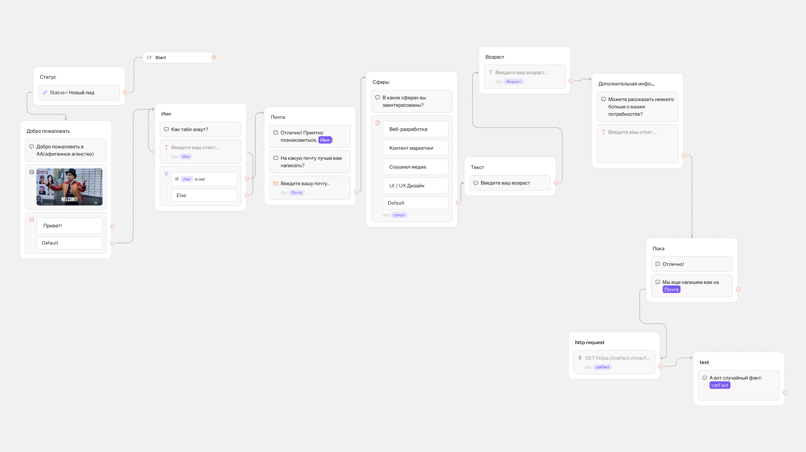

# Лабораторная работа №5. Чат-боты (Трек C: TypeBot)

**Ссылка на бота:** https://typebot.co/lab5-safonchik-bot-slpzq17

## 1. Краткое описание выполненного
Выбран трек C (TypeBot). Создан workspace и бот `lab5-Safonchik-bot` на основе шаблона Lead Generation. Проведена полная русификация шаблона. Добавлены новые блоки: условие (Condition), сбор возраста и дополнительной информации. Настроена интеграция с внешним публичным API (catfact.ninja) через HTTP Request для вывода случайного факта о котах. Бот успешно протестирован и опубликован по веб-ссылке. Экспорт flow сохранен в `exports/flow-01-safonchik-typebot.json`.

## 2. Освоенные блоки и элементы
- **Bubbles (Text/Image/Buttons)**: вывод сообщений, картинок и кнопок.
- **Inputs (Text/Email/Number)**: сбор данных (Имя, Почта, Возраст).
- **Variables**: сохранение и передача данных (в т.ч. `Статус = Новый лид`).
- **Condition**: ветвление логики (проверка ввода имени).
- **HTTP Request**: интеграция с внешним API для получения случайного факта.

## 3. Скриншоты
* Регистрация/создание Workspace: 
* Перевод на русский и настройка переменных: 
* Условие (Condition): 
* Добавление variable: 
* Новый блок (Возраст): 
* Настройка HTTP Request: 
* Финальная схема: 

## 5. Выводы
TypeBot — мощный low-code инструмент для создания чат-ботов. Визуальный редактор позволяет быстро менять логику, добавлять условия и интегрировать внешние сервисы без написания кода. Механизм переменных делает диалог персонализированным. Бесплатного тарифа хватает для небольших проектов.
