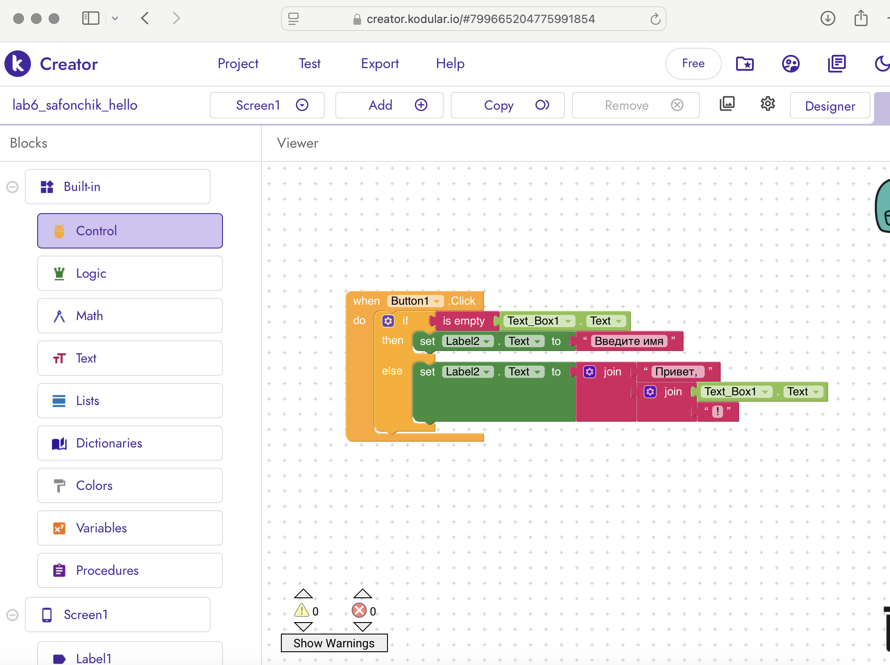
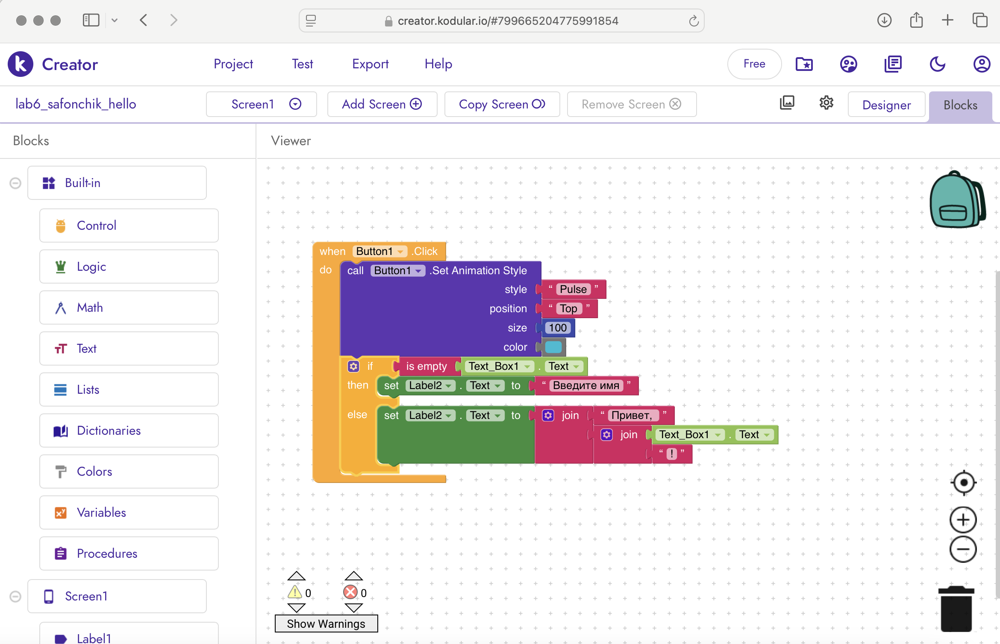

# Лабораторная работа №6. Kodular

**Файл проекта:** lab6/exports/lab6_Safonchik_hello.aia

## 1. Базовое приложение
Создано приложение `lab6_Safonchik_hello` на Screen1. Компоненты: Label1 (заголовок), TextBox1 (Hint: «Ваше имя»), Button1 («Поздороваться»), Label2 (результат), Label3 (фамилия).
 Логика: при нажатии проверяется, пустое ли поле через блок `is empty`. Если пусто — выводится «Введите имя!», иначе — «Привет, <имя>!» через вложенный блок `join`.

* Экран дизайна: 
* Блоки базовой логики: 

## 2. Ачивки

### Ачивка 11: Анимация
В логику кнопки добавлен вызов `Button1.Set Animation Style` с параметрами (style=Pulse, position=top, size=100). Согласно документации Kodular, этот метод запускает встроенную анимацию на кнопке при нажатии, не требуя сторонних расширений.

* Ачивка Анимация: 
## 3. AI-промпты
1. *«Как в Kodular проверить, пустое ли TextBox, и вывести сообщение?»*
2. *«В чём разница между if then  и if then else в Kodular и что лучше использовать в данном случае?»*

## 4. Освоенные компоненты и блоки
- **Компоненты:** Label, TextBox, Button.
- **Блоки:** Button.Click, if then (с добавлением else через шестерёнку), Text.is empty, Text.join, Button.Set Animation Style.

## 5. Выводы
Kodular позволяет создавать Android-приложения из визуальных блоков. Встроенные методы компонентов (например, Set Animation Style) позволяют добавлять визуальную обратную связь без установки расширений.
