## Лабораторная работа 8

### Промпт

Ты — помощник по проектированию баз данных в Notion. Придумай уникальную, небанальную предметную область для учебного проекта. Требования:
- 4 сущности (в Notion — отдельные базы данных);
- минимум 2 связи типа Relation между сущностями;
- у каждой сущности не менее 3 свойств;
- суммарно используй типы свойств: Title, Select, Multi-select, Date, Number, Relation, Formula;
- минимум одна Formula для вычисляемого свойства;
- минимум одна Button с простым действием.
Опиши модель данных: список сущностей, свойства каждой сущности с указанием типа, связи между сущностями и зачем нужна каждая связь. Предметная область должна быть не про задачи, фильмы или рецепты.

## Ответ DeepSeek:
Предметная область: «Учёт оборудования в фотостудии» (Studio Equipment Tracking).

Сущности:

1. Equipment (Оборудование)
   - Name (Title) — название единицы оборудования.
   - Category (Select) — категория: Camera, Lens, Light, Tripod, Audio.
   - Purchase Date (Date) — дата покупки.
   - Price (Number) — стоимость.
   - Status (Select) — Available / In Use / Repair.
   - Total Rentals (Formula) — вычисляемое: количество связанных аренд (см. ниже).

2. Rentals (Аренды)
   - Rental ID (Title) — номер аренды.
   - Client (Title или Text) — имя клиента.
   - Start Date (Date) — дата начала.
   - End Date (Date) — дата окончания.
   - Days (Formula) — вычисляемое: разница между End Date и Start Date.
   - Equipment (Relation → Equipment) — какое оборудование арендовано.
   - Status (Select) — Active / Completed / Cancelled.

3. Clients (Клиенты)
   - Name (Title) — имя клиента.
   - Contact (Text) — телефон/email.
   - Type (Select) — Individual / Company.
   - Rentals (Relation → Rentals) — какие аренды у клиента.
   - Total Spent (Formula) — суммарная стоимость аренд (через Rollup/Formula).

4. Maintenance (Обслуживание)
   - Task (Title) — описание работы.
   - Date (Date) — дата обслуживания.
   - Cost (Number) — стоимость.
   - Equipment (Relation → Equipment) — какое оборудование обслуживается.
   - Type (Select) — Cleaning / Repair / Inspection.

Связи:
- Equipment ↔ Rentals (Relation): одна единица оборудования может быть в многих арендах; нужна для отслеживания загрузки и истории.
- Equipment ↔ Maintenance (Relation): одна единица оборудования имеет много записей обслуживания; нужна для учёта ремонтов.
- Clients ↔ Rentals (Relation): один клиент может иметь много аренд; нужна для истории клиента и подсчёта трат.

Формулы:
- Rentals.Days = dateBetween(prop("End Date"), prop("Start Date"), "days")
- Equipment.Total Rentals = length(prop("Rentals")) или через Rollup count.

Кнопка:
- В базе Rentals кнопка «Mark as Completed» с действием Edit pages → Status = Completed.

После проверки ответа ИИ я:
1. Убрал свойство Client (Title) из Rentals, так как клиент уже связан через Relation с базой Clients — дублирование.
2. Заменил формулу Equipment.Total Rentals на Rollup (Count) по Relation Rentals — так надёжнее в Notion.
3. Добавил в Maintenance свойство Status (Select) — в ответе ИИ его не было, а для учёта обслуживания оно нужно.
4. Уточнил формулу Days: в Notion функция называется dateBetween, а не просто разница.

## 2. Ход выполнения работы (скриншоты)

### Главная страница
Создано рабочее пространство с указанием фамилии в заголовке.
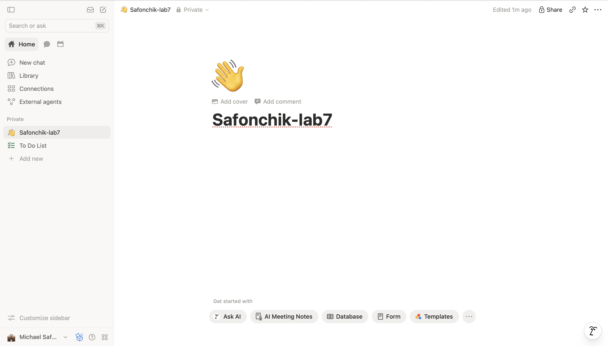

### Связи Relation
Созданы 4 базы данных и настроены двусторонние связи.
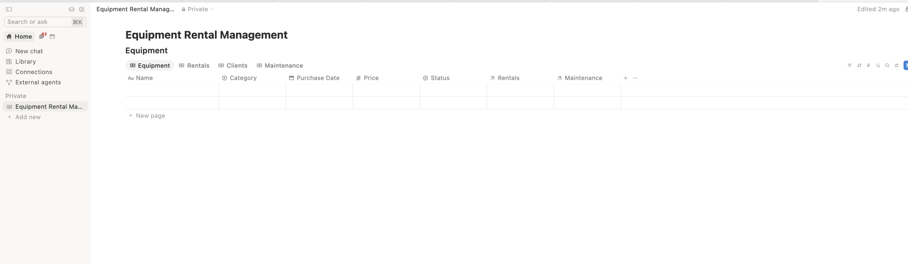
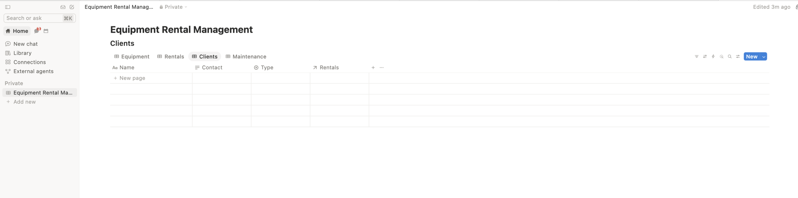

### Наполнение
 В каждую базу данных добавлено более 10 реалистичных записей при помощи ИИ агента notion
пропмт: Добавь минимум по 10 записей в каждую базу. Заполни их реалистичными данными, связывая записи между собой (в столбцах Relation выбирай нужные элементы из выпадающего списка).
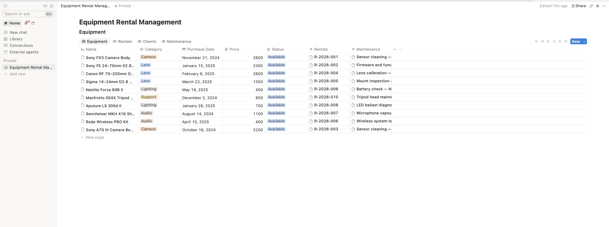
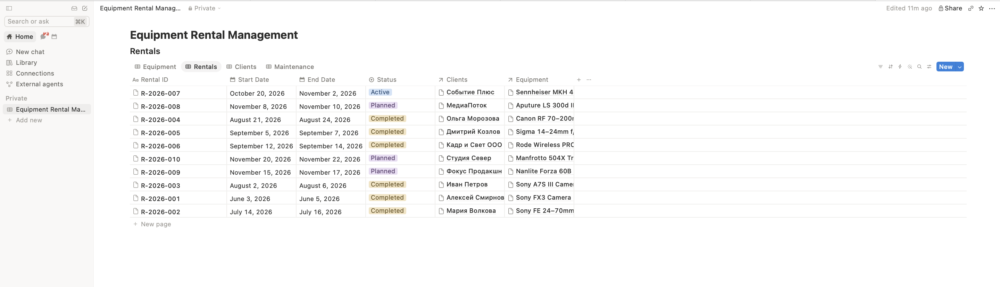
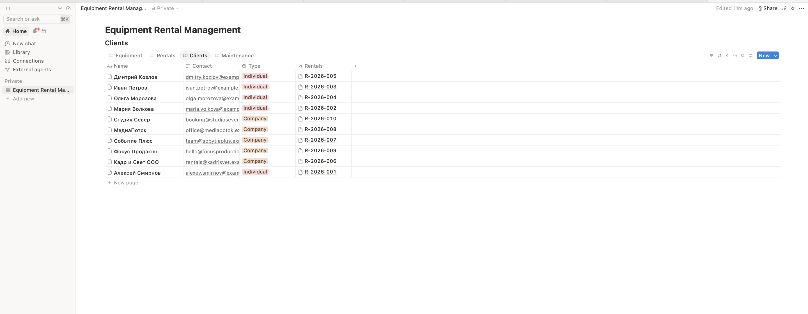
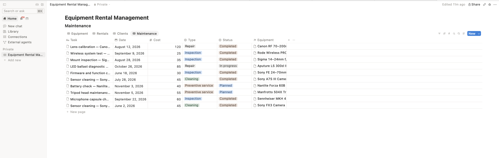

### Представления (Views)
Для базы Rentals создано два представления: таблица и канбан.
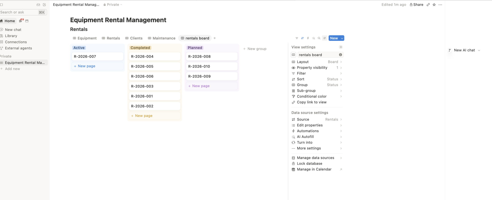

### Формула
В базе Rentals добавлено свойство Formula для расчета количества дней аренды.
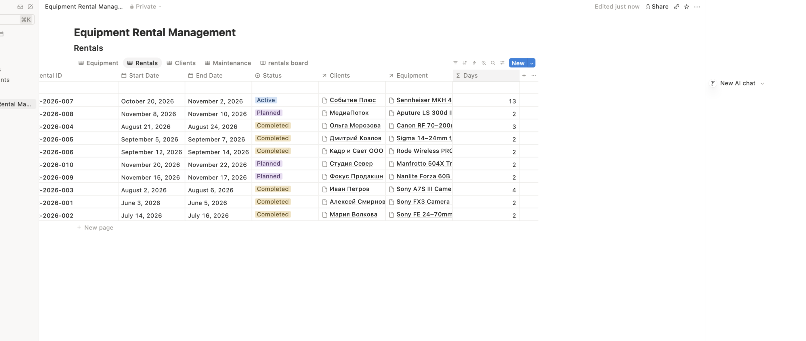
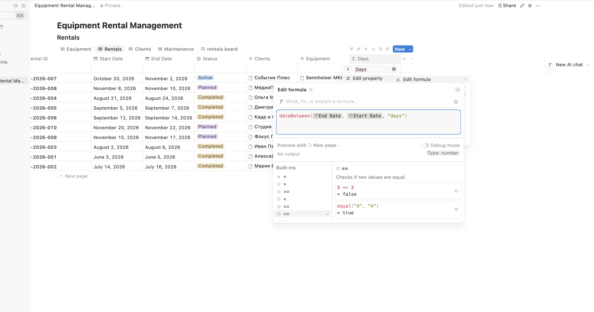

### Кнопка (Button)
В базу Rentals добавлена кнопка, меняющая статус текущей аренды на "Completed".
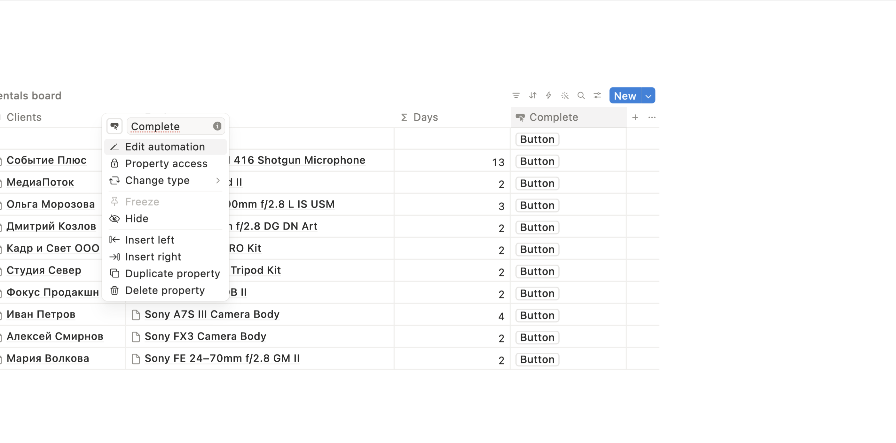
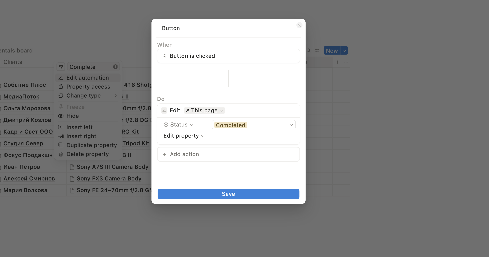

## 3. Ссылка на опубликованную страницу и экспорт
- **Ссылка на Notion:** [Открыть страницу](https://olive-opera-1f6.notion.site/40acce0733bf800b8d4eeae960012ce1?v=a43c3b987e1b4990a13561841edc66ec&source=copy_link)

## 4. Освоенные компоненты и настройки Notion
- Создание баз данных (Database) и настройка свойств: Title, Select, Date, Number, Relation, Formula, Button.
- Настройка связей Relation (включение отображения в обеих базах).
- Создание разных представлений (Table, Board).
- Написание формул (`dateBetween`).
- Настройка автоматизации через кнопки (Button).
- Публикация страницы в веб (Publish) и экспорт в Markdown.

## 5. Выводы
В ходе лабораторной работы я освоил создание связанных баз данных в Notion. Notion позволяет организовать данные гораздо удобнее, чем обычные таблицы. Использование ИИ (DeepSeek) помогло быстро спроектировать структуру и не упустить важные типы свойств
